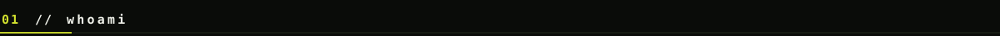
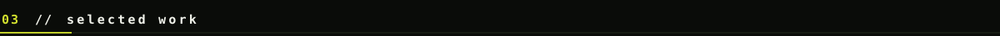
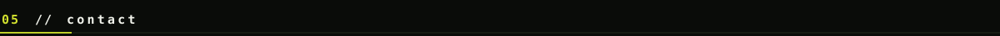

<p align="center">
  <a href="https://eonsecurity.co.za"></a>
  <a href="mailto:hello@eonsecurity.co.za"></a>
  <a href="https://github.com/LAG-Yadav"></a>
</p>



```console
yadav@eon:~$ whoami
yadav iserbelas — offensive security engineer, south africa

yadav@eon:~$ cat mission.txt
I find the way in before someone less friendly does.
Web applications, internal networks, APIs, cloud, Active Directory.
Then I write it up so the fix is obvious to whoever has to pay for it.

yadav@eon:~$ ls ~/now
eon-security/     penetration testing and Active Directory audits
cyberpro/         the blue side, so I know what noise looks like
nexus-scalers/    client builds, when the testing queue is quiet
agentic-tooling/  machines that do the boring half of the job
```

I run **Eon Security**, a South African security firm that does penetration testing and Active Directory
audits. Most of my work is adversarial: get in the way an attacker would, prove it, then hand over
something a technical team can act on and a board can approve.

The other half is building the tooling that makes that repeatable — agent pipelines that enumerate,
triage and draft findings so the human hours go into the parts that actually need judgement.


**Offensive security**
Penetration testing across web applications, APIs, internal networks and cloud tenants.
Active Directory and Entra ID assessment: privilege paths, delegation abuse, certificate services,
tier-0 exposure. Incident response and forensic triage when something has already gone wrong — cloud
email takeover, session token replay, data exfiltration.

**Security engineering**
Agentic testing pipelines, detection content, and the unglamorous automation that stops a finding
being rediscovered six months later. I care more about the report being read than it being long.



| | |
|---|---|
| **EON PentAGI** | Agentic penetration-testing framework. Orchestrated recon, exploitation and reporting profiles driven from one engagement state. |
| **Cloud email takeover response** | Forensic reconstruction of a nine-day AiTM session-hijack against a Microsoft 365 tenant. Full timeline from sign-in logs, exfiltration scope, POPIA exposure and a prioritised remediation roadmap. |
| **Active Directory audit programme** | Repeatable domain assessment covering privilege escalation paths, Kerberos abuse and tier-0 separation, delivered as a technical report plus an executive summary for sign-off. |
| **Security automation** | Herald plugins and CI-side tooling that keep testing evidence, report generation and client delivery in one pipeline instead of four. |


<p align="left">           </p>



```console
yadav@eon:~$ contact --work
web       https://eonsecurity.co.za
mail      hello@eonsecurity.co.za
location  Centurion, Gauteng, South Africa (SAST / UTC+2)
status    taking on penetration testing and AD audit engagements
```

<p align="center"><sub>Authorised testing only. No engagement starts without written scope and permission.</sub></p>
